# CYBER DOJO — Guía visual de personajes

Referencia para generar imágenes nuevas de los cinco luchadores de **CYBER DOJO** (juego de lucha 2.5D, estética cyberpunk nocturna). Cada personaje tiene:

- **Retrato**: la ilustración original, la referencia de estilo principal.
- **Sprite de selección**: la pose de la pantalla de selección.
- **Hoja 360°**: frente, tres cuartos, perfil y espalda, en pose neutra y sin efectos (la usada para el modelo 3D).
- **Modelo 3D**: cómo se ve hoy en el combate.

Todas las imágenes están en [`img/`](img/).

---

## Estilo común (aplicar a todas las imágenes)

- **Ilustración de cómic / anime occidental**: tinta negra marcada, sombreado cel por planos, colores saturados, sin fotorrealismo.
- **Mundo cyberpunk nocturno**: neones, lluvia, callejones japoneses con letreros (kanji), azoteas con skyline iluminado.
- **Armaduras tecnológicas** con líneas de circuito luminosas en el color de acento de cada personaje.
- **Proporciones heroicas** de videojuego de lucha: cuerpo completo, pose dinámica, silueta muy legible.
- **Cada personaje tiene un color propio** (ver su ficha). Úsalo en la luz de borde y en los efectos de energía.
- Para sprites o recortes: **fondo liso** (verde #00FF00 o gris neutro) y el personaje entero en el encuadre, sin cortar pies ni manos.
- No añadir texto, logotipos ni marcas de agua.

> Consejo: pasa siempre el **retrato** y la **hoja 360°** del personaje como imágenes de referencia, y escribe el prompt en inglés.

---

## RYUJIN — Shoto equilibrado

| Retrato | Sprite de selección | Modelo 3D |
|---|---|---|
| 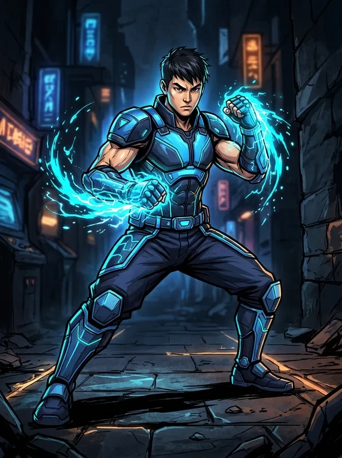 | 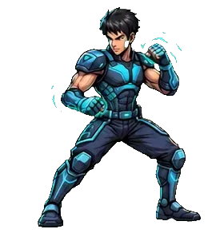 | 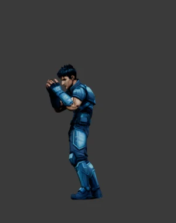 |

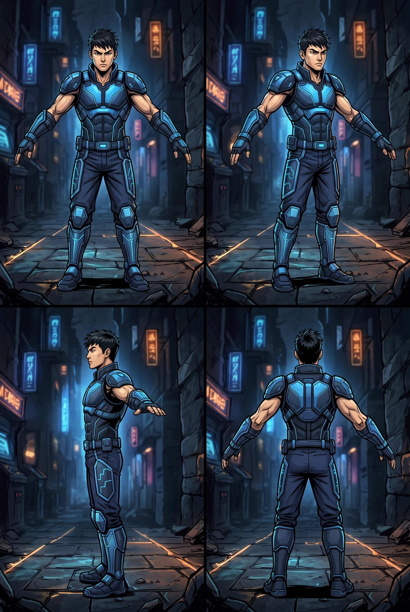

- **Quién es**: el luchador base, disciplinado y equilibrado. Artes marciales clásicas con energía.
- **Aspecto**: joven asiático, pelo negro de punta, expresión decidida. Chaleco táctico azul oscuro con placas segmentadas y cuello alto, bíceps descubiertos, hombreras y guanteletes azules, guantes sin dedos, cinturón con hebilla metálica, pantalón táctico azul con patrones celestes, rodilleras y espinilleras blindadas, botas de combate.
- **Colores**: principal `#0284C7` · acento `#38BDF8` (energía azul eléctrica en puños y antebrazos).
- **Traje alternativo «Satsui Carmesí»**: `#991B1B` / `#F43F5E`.
- **Golpes destacados**: Hadouken (bola de energía), Dragon Uppercut (gancho ascendente), Denjin Palm, Ki Charge Burst. **Super**: CYBER OVERDRIVE!
- **Prompt base**: `Ryujin, young East Asian martial artist with spiky black hair, dark blue armored tactical vest, blue gauntlets with glowing cyan circuit lines, cyan electric energy around his fists, cyberpunk comic style, bold ink outlines, cel shading`

---

## KAZE — Ninja rushdown

| Retrato | Sprite de selección | Modelo 3D |
|---|---|---|
| 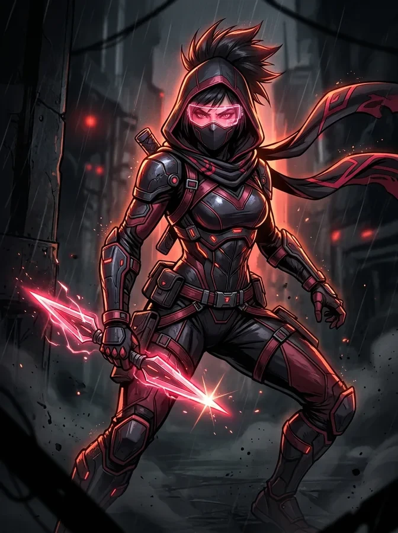 | 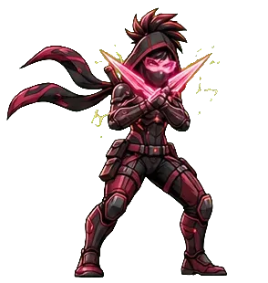 | 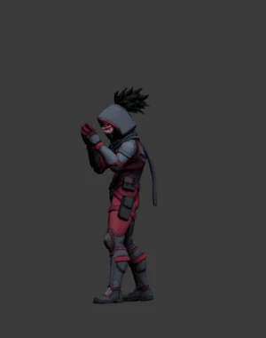 |

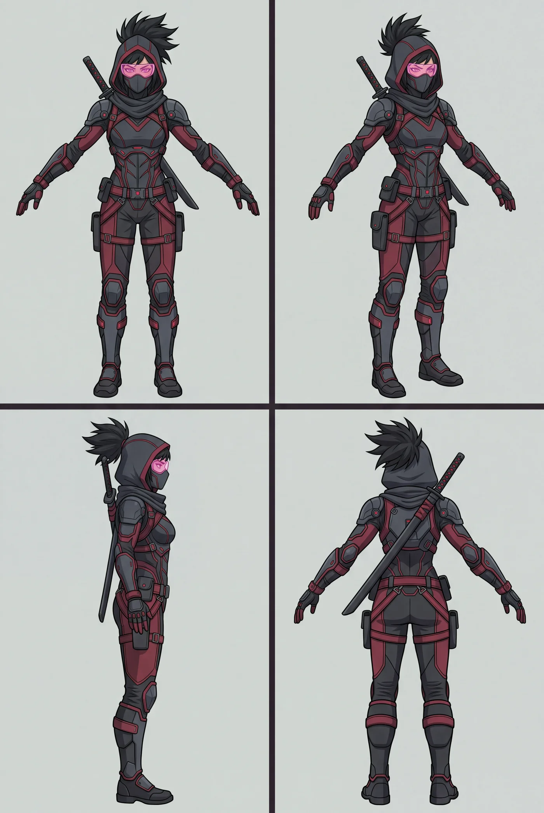

- **Quién es**: ninja rápida y agresiva; presión constante, teletransportes y kunais de plasma.
- **Aspecto**: mujer con capucha gris oscura de ribete rojo, pelo negro de punta que asoma, visor rosa translúcido, máscara de tela en la boca. Armadura gris oscura y carmesí ceñida, arnés con correas, katana envainada a la espalda, cartucheras en los muslos, rodilleras y botas. En las ilustraciones lleva bufanda roja larga al viento y kunais de energía rosa.
- **Colores**: principal `#BE123C` · acento `#FB7185` (energía rosa-carmesí).
- **Traje alternativo «Oro Fantasma»**: `#3730A3` / `#FACC15`.
- **Golpes destacados**: Plasma Kunai, Rising Fang, Shadow Crescent, Mirage Teleport, Kunai Barrage. **Super**: CRIMSON TEMPEST!
- **Prompt base**: `Kaze, female cyber ninja with dark grey hood with red trim, pink glowing visor, face mask, dark grey and crimson fitted armor, katana sheathed on her back, long red scarf, glowing pink plasma kunai, cyberpunk comic style, bold ink outlines, cel shading`

---

## TITAN — Coloso grappler

| Retrato | Sprite de selección | Modelo 3D |
|---|---|---|
| 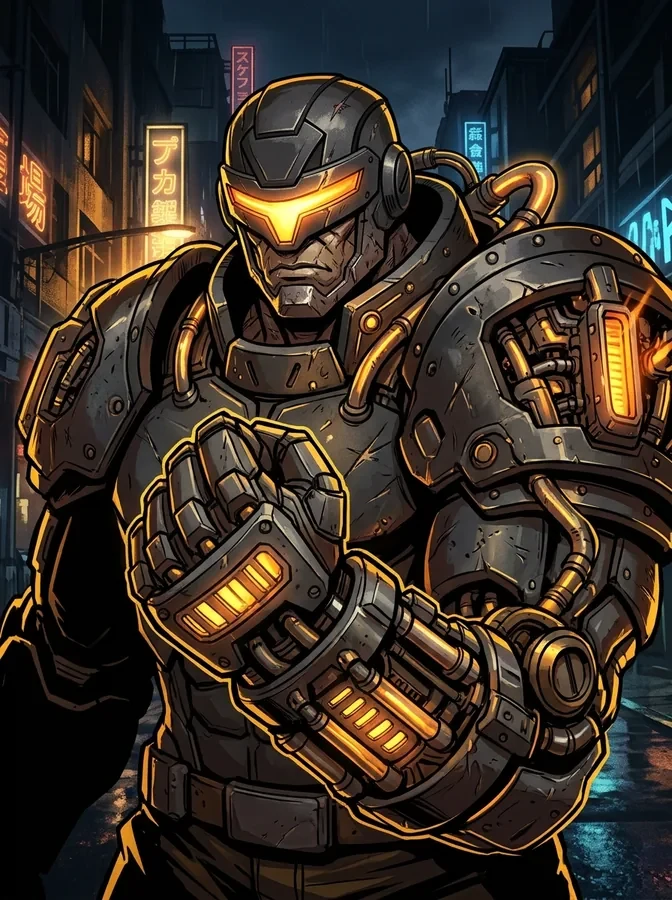 | 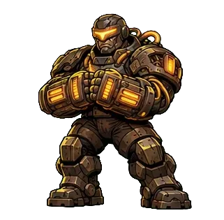 | 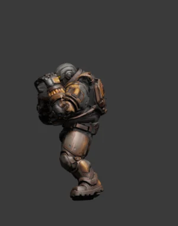 |

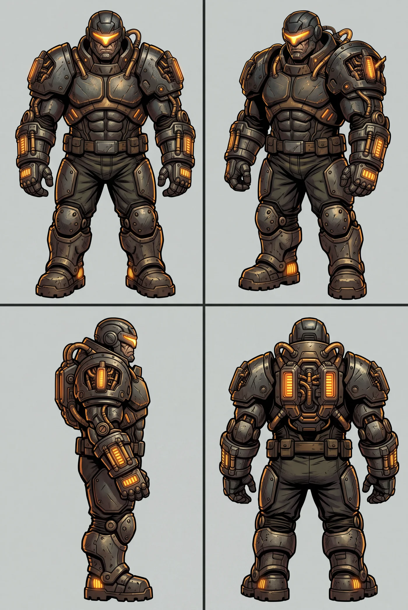

- **Quién es**: gigante acorazado, lento y devastador; agarres de comando y golpes que hacen temblar el suelo.
- **Aspecto**: coloso en armadura pesada de placas metálicas oscuras y bronce, casco con visor amarillo, guanteletes enormes con detalles naranjas brillantes, mochila de potencia a la espalda, botas blindadas. Silueta ancha y maciza.
- **Colores**: principal `#D97706` · acento `#F59E0B` (brillo ámbar-naranja de reactor).
- **Traje alternativo «Cromo Cobalto»**: `#1D4ED8` / `#38BDF8`.
- **Golpes destacados**: Megaton Hammer, Shockwave Cannon, Titan Volcano, Bunker Breaker, Seismic Stomp. **Super**: GIGA TECTONIC!
- **Prompt base**: `Titan, colossal armored powerhouse in heavy dark metal and bronze plate armor, helmet with yellow visor, huge gauntlets with glowing orange details, power pack on his back, massive wide silhouette, cyberpunk comic style, bold ink outlines, cel shading`

---

## VALKYRIE — Aero-duelista

| Retrato | Sprite de selección | Modelo 3D |
|---|---|---|
| 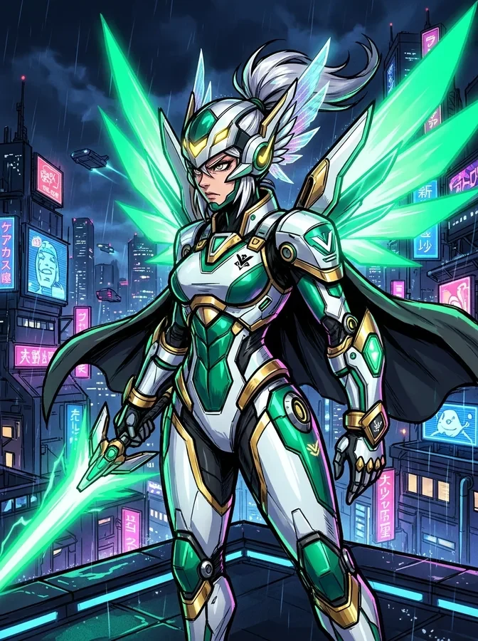 | 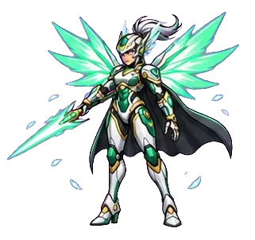 | 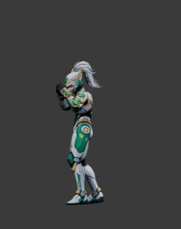 |

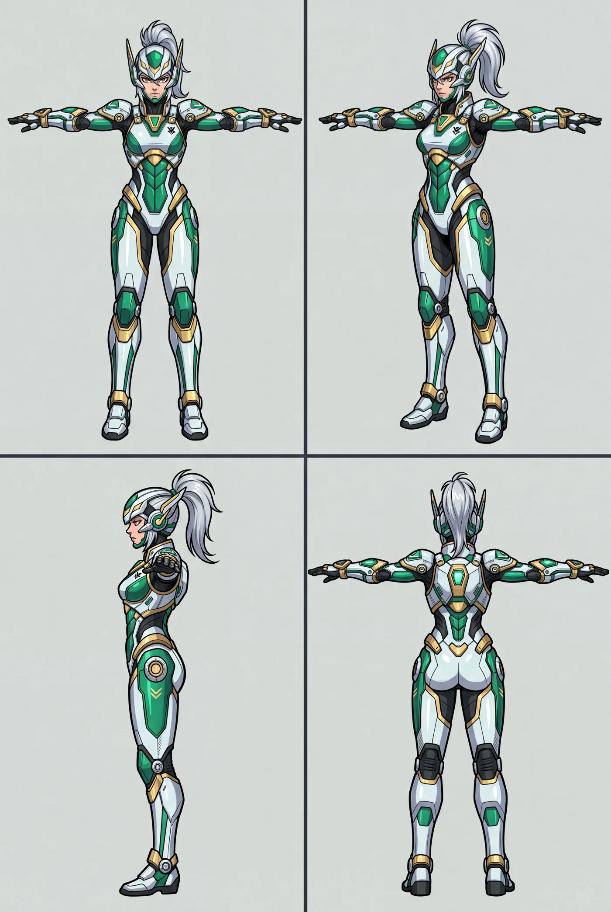

- **Quién es**: duelista aérea elegante; ataques desde el aire, cortes de energía y un gran golpe descendente.
- **Aspecto**: mujer con casco blanco, verde y dorado con pequeñas alas laterales, coleta plateada, armadura de placas blanca, verde esmeralda y oro sobre traje negro. En las ilustraciones lleva **alas de energía verde translúcida**, capa oscura y una lanza de energía. *(El modelo 3D no las lleva; en 2D sí se pueden usar.)*
- **Colores**: principal `#059669` · acento `#34D399` (energía verde esmeralda).
- **Traje alternativo «Serafín Dorado»**: `#9F1239` / `#FBBF24`.
- **Golpes destacados**: Photon Lance, Halberd Overhead, Feather Crescent, Skyward Lance, Valkyrie Cleave. **Super**: SOLAR VALKYRIE!
- **Prompt base**: `Valkyrie, female aerial duelist in white, emerald green and gold plate armor, winged helmet, silver ponytail, translucent glowing green energy wings, dark cape, green energy lance, cyberpunk comic style, bold ink outlines, cel shading`

---

## VOLT — Electro-zoner

| Retrato | Sprite de selección | Modelo 3D |
|---|---|---|
| 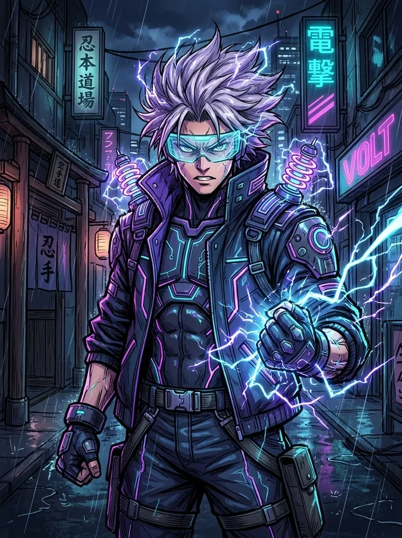 | 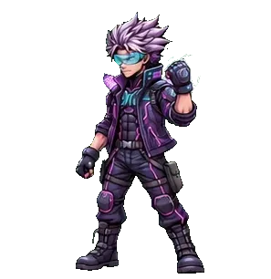 | 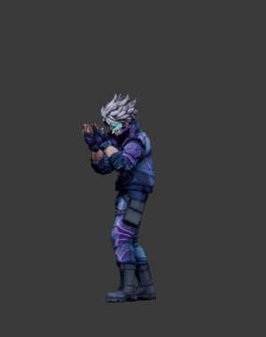 |

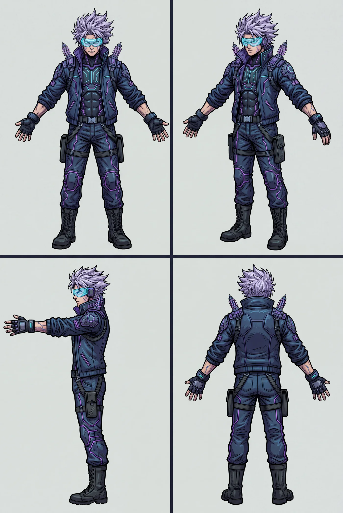

- **Quién es**: lucha a distancia con electricidad; esferas de energía, descargas y control de espacio.
- **Aspecto**: joven de pelo plateado-lila muy de punta, gafas visor cian, chaqueta azul marino de cuello alto con circuitos morados, **bobinas Tesla en los hombros**, traje negro con líneas cian y moradas, guantes tácticos con placas en los nudillos, cinturón con hebilla plateada, botas de combate. En las ilustraciones, rayos morados y cian por todo el cuerpo.
- **Colores**: principal `#6D28D9` · acento `#A855F7` / HUD `#C084FC` (electricidad violeta).
- **Traje alternativo «Voltaje Lima»**: `#0F766E` / `#84CC16`.
- **Golpes destacados**: Volt Sphere, Tesla Rising, Coil Discharge, Shock Arc, Phase Warp. **Super**: MEGAVOLT TEMPEST!
- **Prompt base**: `Volt, young man with spiky silver-lilac hair, cyan visor goggles, navy high-collar jacket with purple circuit lines, small Tesla coils on his shoulders, purple and cyan lightning crackling around him, cyberpunk comic style, bold ink outlines, cel shading`

---

## Plantillas de prompt

Sustituye `<PROMPT BASE>` por el del personaje y adjunta su retrato y su hoja 360° como referencia.

**Hoja de poses (para sprites)**
```
<PROMPT BASE>. Character sprite sheet, 4x4 grid of the same character, consistent design in every frame,
full body, side view facing right, fighting game animation frames: <ANIMACIÓN: idle stance / walk cycle /
punch / kick / hit reaction / victory pose>. Plain flat green background (#00FF00), no shadows on the
background, no text.
```

**Retrato de victoria / derrota**
```
<PROMPT BASE>. Dramatic half-body portrait, <victorious smirk | exhausted and defeated>, neon city at night
in the background, rain, strong rim light in <COLOR DE ACENTO>, fighting game victory screen art, no text.
```

**Arte de presentación (versus)**
```
<PROMPT BASE> facing <OTRO PERSONAJE>, versus screen composition, both full body in dynamic fighting poses,
split background with each character's color, sparks and energy clashing in the middle, no text.
```

**Ilustración de final de Arcade**
```
<PROMPT BASE>. Epilogue illustration after winning the tournament, cinematic wide shot, cyberpunk Tokyo
rooftop at dawn, calm atmosphere, painterly comic style, no text.
```

**Traje alternativo**
```
<PROMPT BASE>, same design but with the alternate color palette: main <COLOR PRINCIPAL ALT>,
accent <COLOR ACENTO ALT>. Keep every shape and detail identical, only recolor.
```
